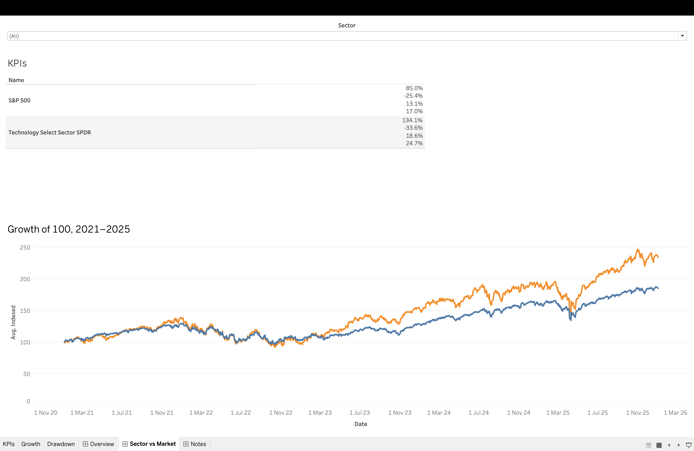
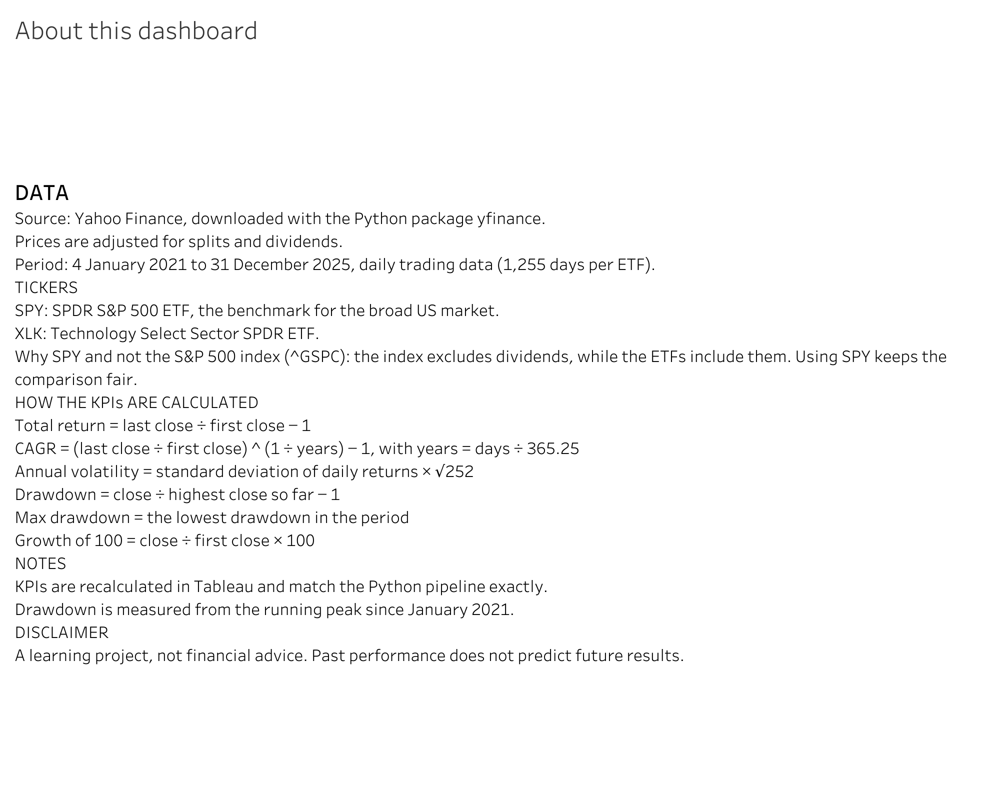

# Global Markets Dashboard: S&P 500 (SPY) vs Technology (XLK), 2021–2025

[](https://github.com/Addyty/markets-dashboard/actions/workflows/tests.yml)

A Python data pipeline and Tableau dashboard comparing the broad US stock market (the S&P 500, through the SPY ETF) with the technology sector (the Technology Select Sector SPDR ETF, XLK) over five years. It shows how much each grew, how far each fell from its peak, and how risky each one was.

**Live dashboard:** [View on Tableau Public](https://public.tableau.com/app/profile/aaditya.tyagi/viz/release1_market/Overview)

**Workbook:** [`tableau/release1_markets.twbx`](tableau/release1_markets.twbx). Open it in Tableau Desktop or Tableau Public.




---

## The question it answers

From 2021 to 2025, how did the broad US market and the technology sector perform, and how much value did investors lose along the way?

## Key results (2021–2025)

| ETF | Total return | CAGR | Annual volatility | Max drawdown | Max drawdown date |
|---|---|---|---|---|---|
| S&P 500 (SPY) | 98.1% | 14.7% | 17.1% | −24.5% | 12 Oct 2022 |
| Technology Select Sector SPDR (XLK) | 134.1% | 18.6% | 24.7% | −33.6% | 12 Oct 2022 |

- **Technology grew faster.** 100 invested in XLK became about 234, compared with about 198 in SPY.
- **Technology was riskier.** XLK was about 45% more volatile than SPY and fell further in every major sell-off: 2022, mid-2024 and April 2025.
- **Both hit their lowest point on the same day,** 12 October 2022, during the 2022 bear market.
- **Tech did not win every year.** XLK beat SPY in 2021, 2023 and 2025, but SPY did better in 2022 (−18.2% vs −27.7%) and 2024 (24.9% vs 21.6%). See [SQL analysis](#sql-analysis).

In short, tech's extra return came with deeper and more frequent losses along the way.

### Risk-adjusted returns and recovery

| ETF | Sharpe | Sortino | Calmar | Max-drawdown recovery | Days to recover | Longest underwater |
|---|---|---|---|---|---|---|
| S&P 500 (SPY) | 0.70 | 1.01 | 0.60 | 13 Dec 2023 | 294 | 489 trading days |
| Technology (XLK) | 0.69 | 0.99 | 0.55 | 15 Jun 2023 | 169 | 369 trading days |

- **After adjusting for risk, the two were almost level.** XLK's higher return was matched by its higher volatility: the Sharpe ratios are 0.70 vs 0.69, and Sortino 1.01 vs 0.99 (risk-free rate 3.2%).
- **Tech fell further but recovered faster.** After the 2022 low, XLK regained its previous peak in 169 trading days (June 2023). SPY took 294 (December 2023).
- **Tech had more large drawdowns.** XLK had five falls of 10% or more from a peak; SPY had two.
- **Volatility was highest in spring 2025,** not in 2022. Three-month rolling volatility peaked at 45% for XLK (April 2025) and 34% for SPY (May 2025).

Risk-free rate, ratio definitions and recovery rules are in [docs/methodology.md](docs/methodology.md).

## What the dashboard shows

| Dashboard | Contents |
|---|---|
| **Overview** | KPI table, a growth-of-100 chart and a drawdown chart, with a filter to pick one or both ETFs |
| **Sector vs Market** | KPI table, total return by sector and the growth-of-100 chart, with a sector filter |
| **Notes** | Data source, date range, KPI definitions and disclaimer |



## How it works

```
Yahoo Finance ──► pull_prices.py ──► data/ (CSV, Excel, SQLite) ──► Tableau Cloud ──► dashboards
                   (download,
                    clean, KPIs)
```

1. **Extract:** `scripts/pull_prices.py` downloads daily prices for SPY and XLK with `yfinance`. Prices are adjusted for splits and dividends.
2. **Validate:** nine data-quality checks run on the raw prices: coverage, duplicates, missing or non-positive prices, high ≥ low, date window and order, aligned trading dates, and the expected day count. If any check fails, or a ticker returns no data, the run stops and nothing is saved.
3. **Transform:** the script stacks both ETFs into one long table and adds daily return, running peak, drawdown, growth-of-100 and rolling volatility and return columns. It then calculates KPIs, risk-adjusted ratios, monthly and annual returns, and every drawdown episode.
4. **Load:** the script saves six tables in a small star schema:
   - `fact_prices`: one row per ETF per trading day (2,510 rows)
   - `dim_ticker`: one row per ETF, with name, sector, asset type and country
   - `kpi_summary`: the headline KPIs and risk ratios per ETF, used to check the Tableau numbers
   - `monthly_returns`, `annual_returns`: one row per ETF per month or year
   - `drawdown_periods`: one row per drawdown episode, with peak, trough and recovery dates

   Columns and grain for every table are in [docs/data_dictionary.md](docs/data_dictionary.md).
5. **Visualise:** Tableau joins the tables with relationships on `ticker`. It recalculates every KPI with its own calculated fields (LOD expressions), and the results **match the Python output exactly**.

## Data source

- **Prices:** Yahoo Finance, downloaded with [`yfinance`](https://github.com/ranaroussi/yfinance), adjusted for splits and dividends.
- **Period:** 4 January 2021 to 31 December 2025, daily, 1,255 trading days per ETF.
- **Tickers:** `SPY` (SPDR S&P 500 ETF) and `XLK` (Technology Select Sector SPDR ETF).
- **Why SPY instead of the S&P 500 index (`^GSPC`):** the index excludes dividends, while ETF prices include them once adjusted. Using SPY compares like with like.

The raw CSV, Excel and SQLite files are not committed. Run the script to regenerate them. The packaged workbook (`tableau/release1_markets.twbx`) includes a data extract so it opens on its own. Yahoo Finance data is for personal, non-commercial use.

## Project structure

```
markets-dashboard/
├── scripts/
│   └── pull_prices.py          # download, validate, calculate KPIs, save outputs
├── data/                       # generated by the script
│   ├── *.csv                   # one file per table (six tables)
│   ├── markets.xlsx            # all six tables as sheets, for uploading to Tableau Cloud
│   └── markets.db              # SQLite copy for the sql/ scripts
├── tableau/
│   └── release1_markets.twbx   # packaged Tableau workbook
├── sql/                        # analysis queries on data/markets.db
├── tests/                      # pytest suite, runs offline on fixed sample data
├── docs/
│   ├── methodology.md          # data basis, return convention, KPI and ratio definitions, checks
│   ├── data_dictionary.md      # grain and columns of every output table
│   └── *.png                   # dashboard screenshots
├── .github/workflows/tests.yml # runs the tests on every push
├── requirements.txt            # packages to run the pipeline
├── requirements-dev.txt        # plus pytest, for running the tests
└── README.md
```

## How to run it

**Requirements:** Python 3.10 or newer.

1. Clone the repository and open a terminal in the project folder.
2. Create and activate a virtual environment:
   ```bash
   python3 -m venv .venv
   source .venv/bin/activate        # Windows: .venv\Scripts\Activate.ps1
   ```
3. Install the packages:
   ```bash
   pip install -r requirements.txt
   ```
4. Run the pipeline:
   ```bash
   python scripts/pull_prices.py
   ```
   It prints a validation report, then the KPIs, and writes six CSV files, `markets.xlsx` and `markets.db` to `data/`.
5. Open `tableau/release1_markets.twbx` in Tableau. Or build your own: upload `data/markets.xlsx` to Tableau Cloud and relate the three tables on `ticker`.

## How the numbers are calculated

| KPI | Formula |
|---|---|
| Total return | last close ÷ first close − 1 |
| CAGR | (last close ÷ first close)^(1 ÷ years) − 1, where years = days ÷ 365.25 |
| Annual volatility | standard deviation of daily returns × √252 |
| Drawdown | close ÷ highest close so far − 1 |
| Max drawdown | the lowest drawdown in the period |
| Growth of 100 | close ÷ first close × 100 |

Returns are measured from the first observed close (4 January 2021), and volatility uses the sample standard deviation. Full details are in [docs/methodology.md](docs/methodology.md).

In Tableau, the first and last close per ETF are found with `{ FIXED [Ticker] : ... }` LOD expressions. That keeps the KPIs correct whichever filters are applied to the ETF or sector.

## SQL analysis

The `sql/` folder holds queries on `data/markets.db`. Each file starts with the business question it answers, and uses window functions (`ROW_NUMBER`, `LAG`, `RANK`) and CTEs.

| Script | Business question | What it found |
|---|---|---|
| `01_data_quality.sql` | Is the data complete and consistent? | 1,255 days per ETF, same date range, no duplicates or bad prices |
| `02_annual_returns.sql` | How did each ETF do each year, and who won? | XLK won 3 of 5 years; SPY won 2022 and 2024 |
| `03_monthly_returns.sql` | What did each ETF return month by month? | 60 monthly returns per ETF, ready for a heatmap |
| `04_best_worst_months.sql` | Best and worst months, and how often up? | Both: best Jul 2022, worst Sep 2022. Up months: SPY 41/60 (68%), XLK 38/60 (63%) |
| `05_drawdown_summary.sql` | How deep were losses, and for how long? | XLK spent 184 days 20%+ below its peak; SPY spent 37 |

Run one from the project folder:

```bash
sqlite3 -header -column data/markets.db < sql/02_annual_returns.sql
```

Yearly and monthly returns from SQL were cross-checked against pandas and compound exactly to the five-year total returns above.

## Testing

```bash
pip install -r requirements-dev.txt
pytest
```

41 tests run in under a second, offline, on fixed sample data with known answers. They cover:

- **KPI formulas:** daily return, drawdown, growth of 100, total return, CAGR, sample volatility × √252, and that each ETF is calculated separately.
- **Risk and recovery:** Sharpe, Sortino and Calmar ratios, rolling windows, drawdown episodes (peak, trough, recovery, open episodes), and monthly and annual returns, including months with no trading.
- **Data validation:** clean data passes, and each kind of bad data (missing ticker, duplicate, missing or negative price, high < low, date outside the window, wrong order, misaligned dates, too few days) is stopped by the specific check meant to catch it.
- **SQL scripts:** every query runs, yearly and monthly returns compound back to the Python total return, and the Python return tables match the SQL results.
- **Outputs:** every table is written as CSV, SQLite and Excel.

GitHub Actions runs the suite on every push (see the badge at the top).

## Limitations

- Only two ETFs so far: the broad market and one sector.
- Yahoo Finance is not an official data source and can contain gaps or later revisions.
- Drawdown is measured from the running peak since January 2021, not from all-time highs.
- The sector filter has only two values for now; it becomes more useful as sectors are added.
- Past performance does not predict future results. This is a learning project, not financial advice.

## Next steps (Release 2)

- Add more sector ETFs: energy, healthcare, financials, consumer and industrials.
- Add a period-comparison view for clearly dated windows (for example, the 2022 sell-off), describing what the data shows without claiming causes.
- Add country-level foreign direct investment data from UNCTAD and the World Bank.

## Author

Aaditya Tyagi · [GitHub](https://github.com/addyty) · [LinkedIn](https://linkedin.com/in/addyty)
