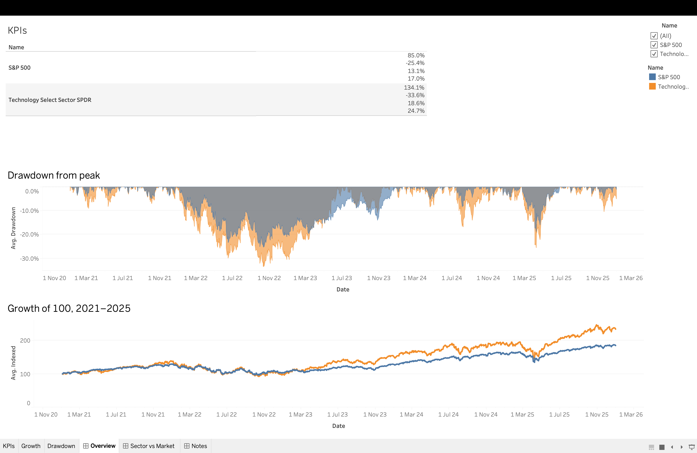

# Global Markets Dashboard: S&P 500 (SPY) vs Technology, 2021–2025

An interactive Tableau dashboard comparing the S&P 500 (through the SPY ETF) with the Technology Select Sector SPDR ETF (XLK) over five years. It shows how much each investment grew, how far each one fell from its peak, and how the two compare sector by sector.

**Live Dashboard:** [View Interactive Dashboard on Tableau Public](https://public.tableau.com/app/profile/aaditya.tyagi/viz/Release1GlobalMarketsSP500vsTechnology20212025/Overview)




---

## The question it answers

Over 2021–2025, how did the broad US market and the technology sector perform, and how much value did investors lose along the way?

## What the dashboard shows

- **Overview:** KPI table (total return, CAGR, annual volatility, max drawdown), a drawdown chart, and a growth-of-100 chart, with a ticker filter.
- **Sector vs Market:** the same KPIs and growth chart, with a sector filter.
- **Notes:** data source, date range, KPI definitions, and a disclaimer.

## Key results (2021–2025)

| Ticker | Total return | CAGR | Annual volatility | Max drawdown | Max drawdown date |
|---|---|---|---|---|---|
| S&P 500 (SPY) | 98.1% | 14.7% | 17.1% | −24.5% | 12 Oct 2022 |
| Technology Select Sector SPDR (XLK) | 134.1% | 18.6% | 24.7% | −33.6% | 12 Oct 2022 |

Technology grew faster but also fell further and was more volatile. Both reached their lowest point on the same day, 12 October 2022, during the 2022 sell-off.

## Data source

- **Prices:** Yahoo Finance, downloaded with the Python package [`yfinance`](https://github.com/ranaroussi/yfinance). Prices are adjusted for splits and dividends.
- **Date range:** 1 January 2021 to 31 December 2025, daily trading data (1,255 trading days per ticker).
- **Tickers:** `SPY` (S&P 500 benchmark) and `XLK` (Technology Select Sector SPDR ETF).
- **Why SPY:** SPY tracks the S&P 500 and its adjusted prices include reinvested dividends, the same as the sector ETFs. The S&P 500 index (`^GSPC`) excludes dividends, so it would not be a fair comparison.

Yahoo Finance data is provided for personal use, so this repository doesn't include the raw data files. Run the script to generate them.

## Project structure

```
markets-dashboard/
├── scripts/
│   └── pull_prices.py      # downloads prices and calculates KPIs
├── data/                   # generated by the script (not committed)
│   ├── fact_prices.csv     # one row per ticker per trading day
│   ├── dim_ticker.csv      # one row per ticker: name, sector, country
│   ├── kpi_summary.csv     # one row per ticker: headline KPIs
│   └── markets.db          # the same three tables in SQLite
├── tableau/
│   └── release1_markets.twb
├── docs/                   # screenshots
├── requirements.txt
└── README.md
```

The data follows a star schema: `fact_prices` holds the daily measurements, `dim_ticker` describes each ticker, and they join on `ticker`.

## How to run it

**Requirements:** Python 3.10 or newer, and Tableau Public or Tableau Desktop.

1. Open a terminal in the `markets-dashboard` folder.
2. Create and activate a virtual environment:
   ```bash
   python3 -m venv .venv
   source .venv/bin/activate
   ```
   On Windows (PowerShell), use `.venv\Scripts\Activate.ps1` instead of the `source` line.
3. Install the packages:
   ```bash
   pip install -r requirements.txt
   ```
4. Run the script:
   ```bash
   python scripts/pull_prices.py
   ```
   It prints the KPI table and writes the four files to `data/`.
5. Open `tableau/release1_markets.twb`. If Tableau can't find the data, use **Data → Edit Data Source** and point it at the CSV files in your `data/` folder.

## How the numbers are calculated

- **Total return:** last close ÷ first close − 1
- **CAGR:** (last close ÷ first close)^(1 ÷ years) − 1, with years = days ÷ 365.25
- **Annual volatility:** standard deviation of daily returns × √252
- **Drawdown:** close ÷ running peak close − 1
- **Max drawdown:** the lowest drawdown in the period
- **Growth of 100:** each close ÷ first close × 100

## Limitations

- Two tickers only: the S&P 500 (via SPY) and one sector ETF.
- Yahoo Finance data isn't an official source and can contain gaps or revisions.
- Drawdown is measured from the running peak since January 2021, so it doesn't reset if you filter to a later start date.
- Past performance doesn't predict future results. This is a learning project, not financial advice.

## Next steps (Release 2)

- Add more sectors (energy, healthcare, financials, consumer, industrials)
- Add an investor wipeout module with event markers (rate decisions, sanctions, AI sell-offs)
- Add country-level FDI data from UNCTAD and the World Bank

## Author

Aaditya Tyagi · [GitHub](https://github.com/addyty) · [LinkedIn](https://linkedin.com/in/addyty)
