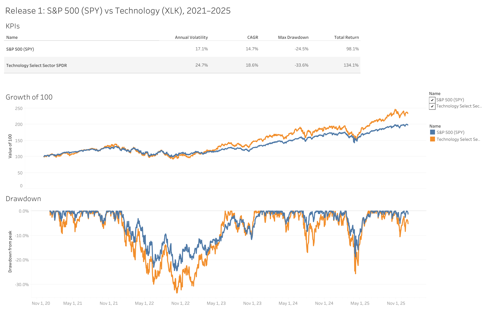
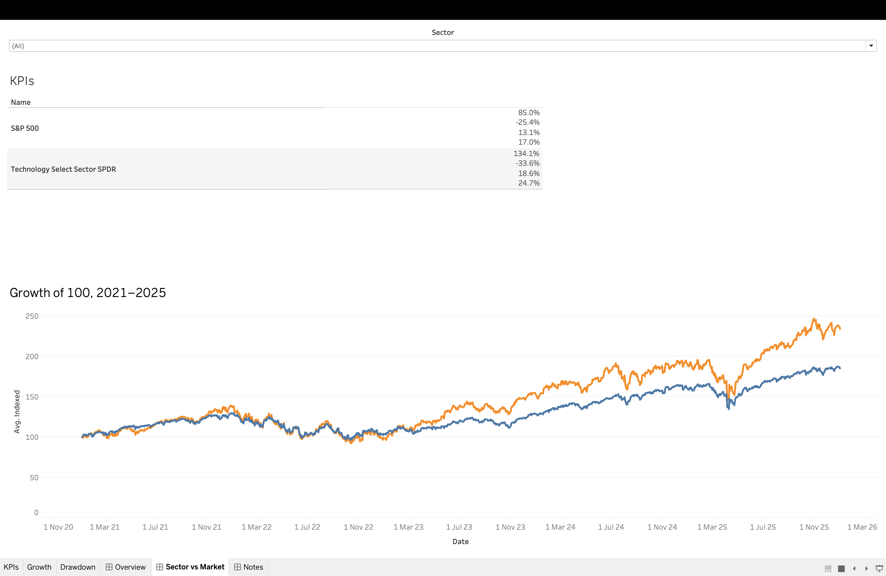

# Global Markets Dashboard: S&P 500 vs Technology, 2021–2025

An interactive Tableau dashboard comparing the S&P 500 with the Technology Select Sector SPDR ETF (XLK) over five years. It shows how much each investment grew, how far each one fell from its peak, and how the two compare sector by sector.

**Live Dashboard:** [View Interactive Dashboard on Tableau Public](https://public.tableau.com:9443/views/Release1GlobalMarketsSP500vsTechnology20212025/Overview?:language=en-GB&:sid=&:redirect=auth&:display_count=n&:origin=viz_share_link)






---

## The question it answers

Over 2021–2025, how did the broad US market and the technology sector perform, and how much value did investors lose along the way?

## What the dashboard shows

- **Overview:** KPI table (total return, CAGR, annual volatility, max drawdown), a drawdown chart, and a growth-of-100 chart, with a ticker filter.
- **Sector vs Market:** the same KPIs and growth chart, with a sector filter so you can compare the two sectors or view them separately.
- **Notes:** data source, date range, KPI definitions, and a disclaimer.

## Key results (2021–2025)

| Ticker | Total return | CAGR | Annual volatility | Max drawdown |
|---|---|---|---|---|
| S&P 500 | 85.0% | 13.1% | 17.0% | −25.4% |
| Technology Select Sector SPDR (XLK) | 134.1% | 18.6% | 24.7% | −33.6% |

Technology grew faster but also fell further and was more volatile. Both fell most sharply in the 2022 sell-off.

## Data source

- **Prices:** Yahoo Finance, downloaded with the Python package [`yfinance`](https://github.com/ranaroussi/yfinance). Prices are adjusted for splits and dividends.
- **Date range:** 1 January 2021 to 31 December 2025, daily trading data.
- **Tickers:** `^GSPC` (S&P 500) and `XLK` (Technology Select Sector SPDR ETF).

Yahoo Finance data is provided for personal use. This project doesn't redistribute the raw data files.

## Project structure

```
markets-dashboard/
├── scripts/
│   └── pull_prices.py      # downloads prices and calculates KPIs
├── data/                   # generated by the script
│   ├── fact_prices.csv
│   ├── dim_ticker.csv
│   ├── kpi_summary.csv
│   └── markets.db
├── tableau/                # Tableau workbook (if saved locally)
├── docs/                   # screenshots
└── README.md
```

## How to run it

**Requirements:** Python 3.10 or newer.

1. Clone or download this repository and open a terminal in the `markets-dashboard` folder.
2. Create and activate a virtual environment:
   ```bash
   python -m venv .venv
   ```
   - Windows (PowerShell): `.venv\Scripts\Activate.ps1`
   - Mac/Linux: `source .venv/bin/activate`
3. Install the packages:
   ```bash
   pip install yfinance pandas
   ```
4. Run the script:
   ```bash
   python scripts/pull_prices.py
   ```
5. The script prints a summary table and writes the four files to `data/`.

Then open Tableau Public (or Tableau Desktop), connect to the CSV files in `data/`, and build the dashboards. The relationships are on the `ticker` column.

## How the numbers are calculated

- **Total return:** last close ÷ first close − 1
- **CAGR:** (last close ÷ first close)^(1 ÷ years) − 1, with years = days ÷ 365.25
- **Annual volatility:** standard deviation of daily returns × √252
- **Drawdown:** close ÷ running peak close − 1
- **Max drawdown:** the lowest drawdown in the period
- **Growth of 100:** each close ÷ first close × 100

## Limitations

- Two tickers only: the S&P 500 and one sector ETF. The project will expand to more sectors and countries.
- Yahoo Finance data isn't an official source and can contain gaps or revisions.
- The sector filter currently has two values, so it's most useful once more sectors are added.
- Past performance doesn't predict future results. This is a learning project, not financial advice.

## Next steps (Release 2)

- Add more sectors (energy, healthcare, financials, consumer, industrials)
- Add an investor wipeout module with event markers (rate decisions, sanctions, AI sell-offs)
- Add country-level FDI data from UNCTAD and the World Bank

## Author

Aaditya Tyagi · [GitHub](https://github.com/addyty) · [LinkedIn](https://linkedin.com/in/addyty)
